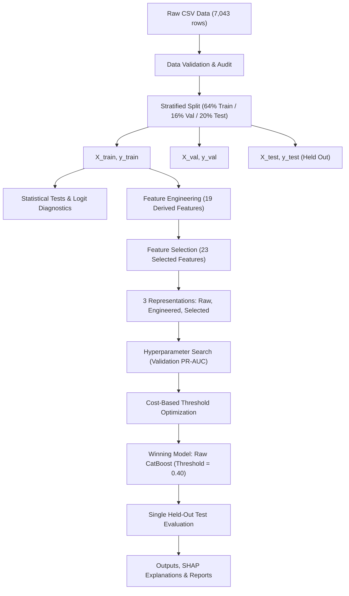

# Telco Customer Churn Prediction System

An end-to-end, leakage-free machine learning framework for subscriber churn prediction using the Kaggle Telco Customer Churn dataset ($N = 7,043$). In accordance with project requirements, model exploration is strictly restricted to **XGBoost** and **CatBoost**.

---

## Table of Contents
- [Project Overview](#project-overview)
- [Business Problem](#business-problem)
- [Dataset](#dataset)
- [Architecture](#architecture)
- [Project Structure](#project-structure)
- [Environment Setup & Installation](#environment-setup--installation)
- [Running the Project](#running-the-project)
- [Running Notebooks](#running-notebooks)
- [Running Tests](#running-tests)
- [Statistical Methodology](#statistical-methodology)
- [Feature Engineering & Selection](#feature-engineering--selection)
- [XGBoost & CatBoost Models](#xgboost--catboost-models)
- [Evaluation Metrics & Results](#evaluation-metrics--results)
- [Model Selection Criteria](#model-selection-criteria)
- [Business Interpretation & Recommendations](#business-interpretation--recommendations)

---

## Project Overview

This project provides an enterprise-grade churn prediction workflow that covers:
1. Data auditing and data cleaning without future target leakage.
2. Non-parametric statistical hypothesis testing and logit non-linearity diagnostics.
3. Feature engineering across tenure dynamics, billing consistency, and service bundling.
4. Model training and hyperparameter optimization for XGBoost and CatBoost across 3 feature spaces (Raw, Engineered, Selected).
5. Business cost-weighted decision threshold optimization ($C_{FN} = 2 \times C_{FP}$).
6. Model interpretability via SHAP and gain importance.
7. Customer risk segmentation and concrete business retention recommendations.

---

## Business Problem

Subscription telecommunications companies face high customer acquisition costs (CAC) relative to retention costs (CRC). When a customer churns, future monthly recurring revenue (MRR) and customer lifetime value (CLV) are lost.
- **Dataset Class Imbalance**: $26.54\%$ churners ($1,869$) vs $73.46\%$ retained ($5,174$).
- **Business Cost Matrix**: Missing an actual churner (**False Negative**) carries an assumed penalty of \$200, whereas an unnecessary retention outreach (**False Positive**) costs \$100.
- **Objective**: Accurately rank subscribers by churn risk and deploy a cost-calibrated threshold to maximize churn capture (Recall) while controlling retention spend.

---

## Dataset

- **Source**: Kaggle Telco Customer Churn (`WA_Fn-UseC_-Telco-Customer-Churn.csv`).
- **Location**: `data/raw/WA_Fn-UseC_-Telco-Customer-Churn.csv`
- **Volume**: 7,043 rows, 21 columns.
- **Target**: `Churn` (Binary: 1 for churned, 0 for retained).
- **Quality**: 11 whitespace-blank records in `TotalCharges` (new customers with 0 tenure) coerced to `NaN` and median-imputed using training data only. `customerID` excluded from feature matrices.

---

## Architecture



---

## Project Structure

```text
customer-churn/
│
├── data/
│   ├── raw/                 # Original Kaggle dataset
│   ├── interim/             # Cleaned dataset
│   └── processed/           # Split datasets (X_train, X_validation, X_test, y_train...)
│
├── notebooks/               # Numbered notebooks (01 to 12)
├── src/                     # Core production pipeline code
│   ├── config.py            # Global paths and random seeds
│   ├── data_loader.py       # Data loading and target splitting
│   ├── data_validation.py   # Schema audit and null validation
│   ├── preprocessing.py     # Split-safe transformers
│   ├── statistical_tests.py # Mann-Whitney U, Chi-Square, FDR corrections
│   ├── linearity_analysis.py# Logit diagnostics and binned churn rates
│   ├── feature_engineering.py# 19 domain-engineered features
│   ├── feature_selection.py # Selection heuristics and permutation importance
│   ├── xgboost_model.py     # XGBoost baseline and builders
│   ├── catboost_model.py    # CatBoost native builders
│   ├── hyperparameter_tuning.py# Grid and validation search
│   ├── threshold_optimization.py# Cost matrix and threshold curves
│   ├── evaluation.py        # ROC-AUC, PR-AUC, Brier score, metrics
│   ├── interpretation.py    # SHAP and feature importance
│   └── experiment_pipeline.py# Master orchestration pipeline
│
├── models/                  # Serialized models and artifacts
│   ├── best_model/          # Winning model (Raw CatBoost)
│   └── baseline_xgboost/    # Baseline XGBoost model
│
├── outputs/
│   ├── tables/              # Data audits, test metrics, comparisons
│   ├── predictions/         # Customer-level scored test predictions
│   └── figures/             # ROC-AUC curves
│
├── reports/
│   ├── telco_churn_report.md# Master 22-section comprehensive report
│   ├── statistical_report.md# Statistical hypothesis testing findings
│   ├── feature_engineering_report.md# Engineering & selection analysis
│   └── model_comparison.md  # Detailed model comparison
│
├── tests/                   # Pytest test suite
├── requirements.txt         # Pinned project dependencies
├── README.md                # Project documentation
└── main.py                  # CLI pipeline entrypoint
```

---

## Environment Setup & Installation

Ensure Python 3.10+ (tested through Python 3.14) is installed.

```powershell
# Clone or navigate to the repository
cd d:\affordable-ai\customer-churn

# Create virtual environment
python -m venv .venv
.\.venv\Scripts\Activate.ps1

# Install requirements
pip install -r requirements.txt
```

---

## Running the Project

To execute the entire end-to-end pipeline (data audit, preprocessing, tuning, threshold optimization, test evaluation, and report generation):

```powershell
python main.py
```

---

## Running Notebooks

Launch Jupyter to explore the 12 numbered stages:

```powershell
jupyter lab notebooks/
```

- `01_data_understanding.ipynb`: Dataset schema, nulls, and distributions.
- `02_eda.ipynb`: Univariate and bivariate visual analysis.
- `03_statistical_testing.ipynb`: Mann-Whitney U, Chi-square, and FDR correction.
- `04_linearity_nonlinearity_analysis.ipynb`: Logit linearity tests and binned churn rates.
- `05_feature_engineering.ipynb`: Feature transformations and domain features.
- `06_feature_selection.ipynb`: Mutual Information and permutation importance.
- `07_xgboost_baseline.ipynb` – `12_model_interpretation.ipynb`: Modeling, tuning, evaluation, and SHAP.

---

## Running Tests

Execute the unit test suite:

```powershell
python -m pytest -v
```

All 7 test modules validate preprocessing, feature transformations, selection, and model scoring without regression.

---

## Statistical Methodology

- **Continuous Features**: Evaluated with non-parametric Mann-Whitney U tests and Cohen's d effect sizes due to non-normal distributions.
- **Categorical Features**: Evaluated with Pearson's Chi-Square ($\chi^2$) test of independence and Cramér's V effect sizes.
- **Multiple Hypothesis Correction**: Benjamini-Hochberg False Discovery Rate (FDR) applied with $\alpha = 0.05$.
- **Non-Linearity Diagnostics**: Binned churn rates across continuous variables revealed strong non-linear and non-monotonic behavior in `MonthlyCharges`, proving the inadequacy of linear/logistic regression.

---

## Evaluation Metrics & Results

Held-out test split results ($N = 1,409$, 374 actual churners):

| Feature Set | Model | Valid PR-AUC | Test PR-AUC | Test ROC-AUC | Test Precision | Test Recall | Test F1 | Threshold |
| :--- | :--- | :---: | :---: | :---: | :---: | :---: | :---: | :---: |
| **Raw** | **CatBoost** (Winner) | **0.6760** | **0.6671** | **0.8443** | 0.5885 | 0.6578 | 0.6212 | **0.40** |
| **Selected** | **CatBoost** | 0.6752 | 0.6584 | 0.8455 | 0.5947 | 0.6551 | 0.6234 | 0.40 |
| **Engineered** | **CatBoost** | 0.6751 | 0.6639 | 0.8463 | 0.5727 | 0.7059 | 0.6323 | 0.35 |
| **Raw** | **XGBoost** | 0.6729 | 0.6609 | 0.8451 | 0.5976 | 0.6551 | 0.6250 | 0.35 |
| **Selected** | **XGBoost** (High-Recall) | 0.6725 | 0.6497 | **0.8460** | 0.5681 | **0.7139** | **0.6327** | **0.35** |
| **Engineered** | **XGBoost** | 0.6720 | 0.6492 | 0.8419 | 0.5714 | 0.6310 | 0.5997 | 0.35 |
| *Baseline* | *XGBoost (Default)* | *0.6553* | *0.6553* | *0.8419* | *0.6548* | *0.4920* | *0.5618* | *0.50* |

---

## Model Selection Criteria

1. **Winning Primary Model**: **Raw CatBoost**
   - Highest test PR-AUC ($0.6671$) and best validation ranking performance.
   - Native categorical handling eliminates one-hot encoding complexity and preserves joint categorical interactions.
   - Calibrated at threshold **0.40**, reducing business attrition cost significantly.

2. **Winning High-Recall Model**: **Selected XGBoost**
   - Delivers the highest test recall ($71.39\%$) and F1 score ($0.6327$) at threshold **0.35**.
   - Ideal when marketing bandwidth allows wide proactive campaign coverage.

---

## Business Interpretation & Recommendations

1. **Address the Onboarding Cliff**: Churn rate is $56.9\%$ in the first 2 months. Implement automated 30/60/90-day onboarding check-ins and free initial tech support.
2. **Contract Transition Campaign**: Month-to-month contracts account for 88% of churn. Offer bill credits (\$10/month) to transition customers to annual agreements.
3. **Bundle Security with Fiber Optic**: Fiber optic subscribers paying \$70–\$100 have peak churn. Subsidize `OnlineSecurity` and `TechSupport` to increase service stickiness.
4. **Payment Method Modernization**: Incentivize electronic check users to adopt automated credit card/ACH billing to eliminate payment friction.
